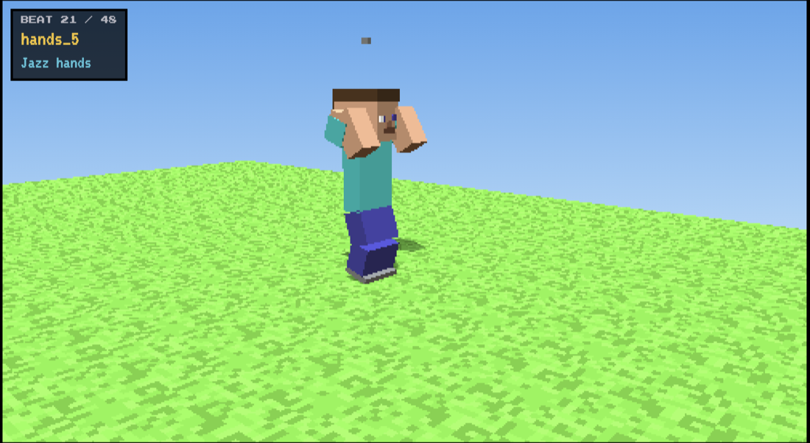

# Steve's Moonwalk

**EECS 367 (AutoRob), Project 3 portfolio.** A Minecraft-style robot performs a finite-state-machine
moonwalk. The page has a video of the performance and an interactive three.js replay that draws the
robot from the 4x4 matrices my forward-kinematics runtime published on `/xform_world`.

## What is on the page

- **Video** of the robot dancing, recorded from my viewer while `make demo` drove it.
- **Live replay**: one recorded loop of `/xform_world`, drawn with three.js. Orbit, follow camera, a timeline you can click, and synthesized background music (Web Audio, no audio files).
- **Write-up**: the robot (25 links, 12 movable joints), the choreography (48 states, 120 BPM), and how the robot is drawn.

## Run it locally

It is a static site with no build step:

    python3 -m http.server 8000      # then open http://localhost:8000

(Opening `index.html` straight from disk will not work: the page fetches its data files.)

## Layout

| Path | What |
|---|---|
| `index.html`, `css/style.css` | the page |
| `js/viewer.js` | URDF "looks" parser, replay player, camera, timeline |
| `js/music.js` | the synthesized music, sharing one clock with the dance |
| `assets/minecraft_steve.urdf` | the robot the viewer draws |
| `assets/moonwalk.json` | the FSM choreography (48 states) |
| `assets/replay.json` | one recorded loop of `/xform_world` (634 frames x 25 links, ~1 MB) |
| `tools/record_replay.py` | records `replay.json` from a running `make demo` |
| `media/moonwalk.mp4` | the demo video (**you add this**, see below) |

## Recording the video (course deliverable)

1. `cd submission && make demo`, then in another terminal `python3 viewer/server.py` and open <http://127.0.0.1:8080>.
2. Load `minecraft_steve.urdf`, pick **moonwalk**, click **Side view**, tick "Start/stop with choreography".
3. Start a screen recording (macOS: `Cmd+Shift+5`, "Record Selected Portion", drag over the 3D view; enable the microphone only if you want narration. System audio needs a loopback tool, so the music may not be captured. If it isn't, record the replay page's music button instead, or add the track in an editor).
4. Click **Start**, let it run one full loop (24 s) or two, stop recording.
5. Compress and save as `media/moonwalk.mp4` (keep it under ~25 MB for a plain git repo):

       ffmpeg -i recording.mov -vf "scale=1280:-2" -c:v libx264 -crf 26 -preset slow -an -movflags +faststart media/moonwalk.mp4

   (drop `-an` if the recording has sound you want to keep)

## Re-recording the replay

If you change the choreography or robot, with `make demo` running:

    python3 tools/record_replay.py

It waits out one full loop, then records the second one, so the replay loops seamlessly.

## Publishing on GitHub Pages

1. Create an empty repository on GitHub (no README/license, they already exist here).
2. `git remote add origin <your repo url>` and `git push -u origin main`.
3. Repository **Settings -> Pages -> Build and deployment -> Deploy from a branch -> `main` / `(root)`**.
4. After a minute the site is at `https://<your-username>.github.io/<repo-name>/`.

## Credits

three.js r128 (MIT). Fonts: Press Start 2P and VT323 (SIL OFL). Music is synthesized in the browser.
Minecraft is a trademark of Mojang Studios; this fan-style robot is made of plain boxes and is not affiliated with or endorsed by them.
